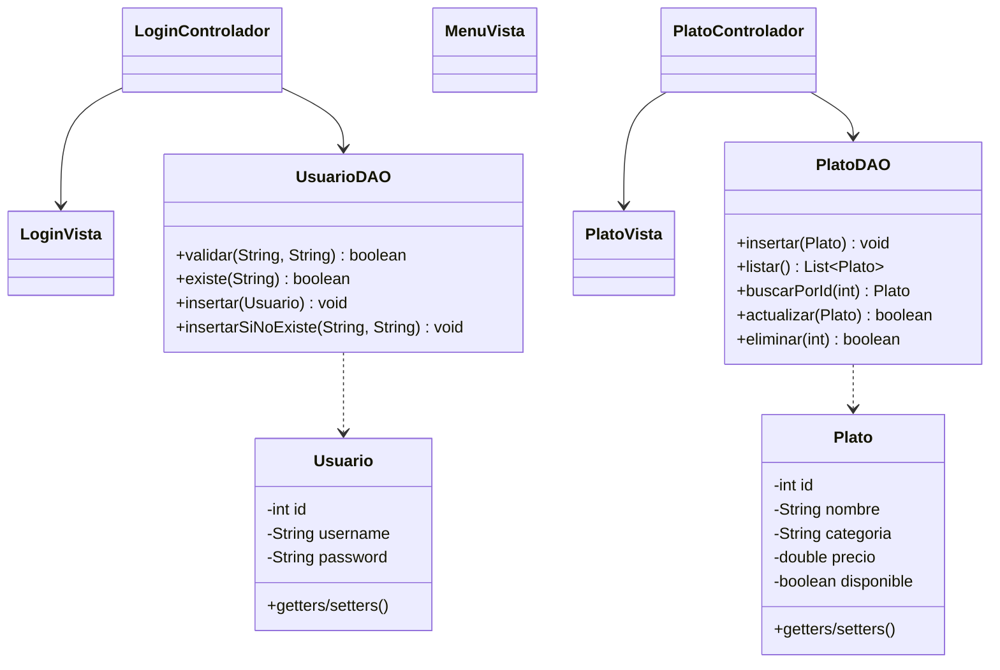

# Diseño del sistema — Sabor Local

> **Fase 1 de la Guía 2.** Este documento debe estar completo y aprobado por los tres
> integrantes antes de empezar a programar el CRUD.
> Responsable de la redacción: **Juan Pablo Arismendy**.

## 1. Nombre y temática

| | |
|---|---|
| **Sistema** | Sabor Local |
| **Temática** | Administración de los platos de un restaurante |
| **Integrantes** | Daniel Ochoa Taborda · Jeronimo Henao · Juan Pablo Arismendy |

**Descripción:** el sistema permite que un usuario autenticado administre el menú del
restaurante: registrar platos, consultarlos, actualizar sus datos y eliminarlos.
Cada plato tiene nombre, categoría, precio y disponibilidad.

## 2. Diagrama de clases

> TODO (Juan Pablo): reemplazar por el diagrama real. Se puede usar Mermaid (VS Code lo
> previsualiza con la extensión Markdown Preview Mermaid) o una imagen exportada de draw.io.



**Relación con la base de datos:** `UsuarioDAO` gestiona la tabla `usuarios` y `PlatoDAO`
gestiona la tabla `platos`. Ninguna vista ni controlador escribe SQL directamente.

## 3. Esquema de la base de datos

```sql
CREATE TABLE IF NOT EXISTS usuarios (
    id       INTEGER PRIMARY KEY AUTOINCREMENT,
    username TEXT NOT NULL UNIQUE,
    password TEXT NOT NULL
);

CREATE TABLE IF NOT EXISTS platos (
    id         INTEGER PRIMARY KEY AUTOINCREMENT,
    nombre     TEXT NOT NULL,
    categoria  TEXT NOT NULL,
    precio     REAL NOT NULL,
    disponible INTEGER NOT NULL DEFAULT 1
);
```

## 4. Responsabilidades por capa

| Capa | Clases | Responsable |
|---|---|---|
| Modelo | `Usuario`, `Plato` | Daniel |
| Datos (DAO) | `UsuarioDAO`, `PlatoDAO`, `ConexionDB`, `InicializarDB` | Daniel |
| Seguridad / flujo | `LoginVista`, `LoginControlador`, `Guia2App` | Jeronimo |
| Interfaz CRUD | `MenuVista`, `PlatoVista`, `PlatoControlador` | Juan Pablo |

## 5. Datos de prueba

| Usuario | Contraseña |
|---|---|
| `admin` | `admin123` |
| `empleado` | `emp456` |

| Plato | Categoría | Precio | Disponible |
|---|---|---|---|
| Bandeja paisa | Fuerte | 28000 | Sí |
| Ajiaco santafereño | Fuerte | 25000 | Sí |
| Limonada natural | Bebida | 6000 | Sí |
| Tres leches | Postre | 9000 | No |

## 6. Aprobación

- [ ] Daniel Ochoa Taborda
- [ ] Jeronimo Henao
- [ ] Juan Pablo Arismendy
